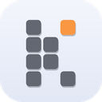
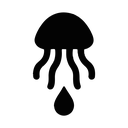
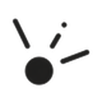
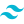

Ayumu Yoshie です。FreeWiFi という名前で活動しています。

Web サービスやツールを、作るところから公開して動かし続けるところまで一人でやっています。前は Discord Bot を中心に作っていました。

花火が好きです。毎日の中で気づいたら使っている、そういうものを作るのが好きです。

## 作ったもの

<table>
  <tr>
    <td width="72" align="center">
      
    </td>
    <td>
      <a href="https://kumikey.hanabi.jp"><b>KumiKey</b></a> 
      配置を自由に作れる日本語フリックキーボード。12キーや候補欄を指で動かして、片手でも両手でも、手に合う並びで打てます。
    </td>
  </tr>
  <tr>
    <td width="72" align="center">
      <a href="https://kurage.ink">
        <picture>
          <source media="(prefers-color-scheme: dark)" srcset="assets/icons/kurage-on-dark.png" />
          
        </picture>
      </a>
    </td>
    <td>
      <a href="https://kurage.ink"><b>kurage.ink</b></a> 
      フィルムで撮った写真を載せているサイトです。
    </td>
  </tr>
  <tr>
    <td width="72" align="center">
      <a href="https://hanabi.jp">
        <picture>
          <source media="(prefers-color-scheme: dark)" srcset="assets/icons/hanabi-on-dark.png" />
          
        </picture>
      </a>
    </td>
    <td>
      <a href="https://hanabi.jp"><b>hanabi.jp</b></a> 
      自分のサイトです。作ったものと書いたものをここにまとめています。
    </td>
  </tr>
</table>

ほかに [ferricord](https://github.com/FreeWiFi7749/ferricord) も作りました。Rust と Python を組み合わせた、速さ重視の Discord API ラッパーです。

## 使っているもの

**よく書く言語**

 TypeScript
&nbsp;&nbsp;
 Python

**触ったことがある言語**

<picture><source media="(prefers-color-scheme: dark)" srcset="assets/icons/rust-on-dark.svg" /></picture> Rust
&nbsp;&nbsp;
 Swift

**よく使うもの**

 Qwik
&nbsp;&nbsp;
 Tailwind CSS
&nbsp;&nbsp;
 Cloudflare Workers

## この1年

直近12か月のコントリビューションです。光の筋1本が1日で、長いほどその日にたくさん書いています。毎日自動で描き直しています。

## 連絡先

お仕事や相談は [contact@hanabi.jp](mailto:contact@hanabi.jp) まで。

<picture><source media="(prefers-color-scheme: dark)" srcset="assets/icons/x-on-dark.svg" /></picture> [@ayumu_hanabi](https://x.com/ayumu_hanabi)
&nbsp;·&nbsp;
[hanabi.jp](https://hanabi.jp)
